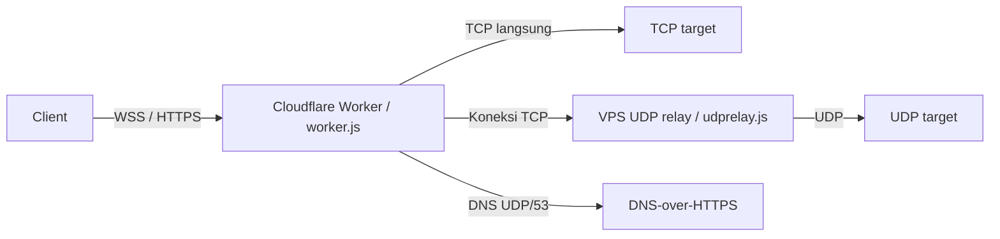

# cfw2ray

Worker Cloudflare buat jalanin VLESS, Trojan, VMess, dan Shadowsocks langsung dari edge Cloudflare. Karena Worker sendiri nggak bisa handle UDP, trafik UDP-nya di-relay ke VPS lewat koneksi TCP.

## Cara kerjanya



Singkatnya: client konek ke Worker via WebSocket/HTTPS, lalu Worker yang mutusin mau diteruskan ke mana — TCP langsung, DNS-over-HTTPS (untuk query DNS di port 53), atau diteruskan ke VPS relay kalau itu trafik UDP biasa.

## Setup `worker.js`

Buka `worker.js`, terus edit bagian `CONFIG` di paling atas:

```js
const CONFIG = Object.freeze({
    UUID: 'UUID-ANDA',
    SS_METHOD: 'aes-128-gcm',
    UDP_RELAY_HOST: 'IP-VPS-ANDA',
    UDP_RELAY_PORT: 8443,
    MAX_PROTOCOL_HEADER: 4096,
    MAX_TCP_PROXY_REPLAY: 4 * 1024 * 1024,
    REJECT_UDP_443: true,
    DNS_DOH_URLS: [
        'https://cloudflare-dns.com/dns-query',
        'https://dns.google/dns-query',
    ],
    DNS_DOH_TIMEOUT_MS: 5000,
});
```

Beberapa hal yang perlu diperhatikan:

- **`UUID`** — dipakai bareng buat VLESS, VMess, Trojan, sama Shadowsocks legacy. Bikin sendiri di [uuidgenerator.net](https://www.uuidgenerator.net/).
- **`UDP_RELAY_HOST`** — isi dengan IP atau hostname VPS kamu.
- **`UDP_RELAY_PORT`** — pastikan nilainya sama persis dengan `LISTEN_PORT` di `udprelay.js`.
- **`SS_METHOD`** — samain juga sama method yang dipakai di client Shadowsocks kamu.

## Setup `udprelay.js`

Ini yang jalan di VPS. Edit juga bagian `CONFIG`-nya:

```js
const CONFIG = Object.freeze({
    LISTEN_HOST: '0.0.0.0',
    LISTEN_PORT: 8443,
    HANDSHAKE_TIMEOUT_MS: 10000,
    IDLE_TIMEOUT_MS: 300000,
    XUDP_GRACE_MS: 60000,
    MAX_CONNECTIONS: 4096,
    REJECT_UDP_443: true,
});
```

Yang penting, `LISTEN_PORT` di sini harus sama dengan `UDP_RELAY_PORT` yang tadi diisi di Worker.

## Jalanin relay-nya

`udprelay.js` perlu jalan di server (VPS) dengan Node.js versi 18 ke atas. Tinggal jalankan biasa:

```bash
node udprelay.js
```

VPS-nya cukup buka akses TCP masuk di port `LISTEN_PORT`

## Deploy Worker-nya

Deploy-nya lewat Cloudflare Dashboard:

1. Buka **Workers & Pages**.
2. Klik **Create application → Create Worker → Deploy**.
3. Klik **Edit code**.
4. Hapus kode contoh bawaan, ganti dengan seluruh isi `worker.js`.
5. Klik **Save and Deploy**.

Setelah itu Worker kamu udah bisa diakses lewat subdomain `workers.dev` bawaan, atau kalau mau pakai domain sendiri, tinggal tambahin di **Settings → Domains & Routes → Add → Custom Domain**.

## Cara pakai di client

Setup client-nya gampang: pakai alamat Worker kamu dan pilih transport WebSocket atau XHTTP mode stream-one

| Protokol | Path | Credential |
| --- | --- | --- |
| VLESS | `/vless` | UUID = `CONFIG.UUID` |
| Trojan | `/trojan` | Password = `CONFIG.UUID` |
| VMess | `/vmess` | ID = `CONFIG.UUID` |
| Shadowsocks | `/ss` | Password = `CONFIG.UUID` (method legacy) |

## Proxy IP

Proxy IP digunakan sebagai alamat alternatif untuk mengakses host atau IP Cloudflare yang tidak dapat diakses langsung oleh Cloudflare Worker.

Tambahkan `host:port` di belakang path:

```text
/vless/host:port
/trojan/host:port
/vmess/host:port
/ss/host:port
```

Misalnya:

```text
/vless/192.0.2.10:8080
```

## Yang perlu diketahui

- Query DNS di UDP port 53 otomatis dialihkan lewat DNS-over-HTTPS, jadi nggak lewat relay VPS.
- Trafik UDP selain port 53 diteruskan ke VPS relay.
- UDP di port 443 bakal ditolak kalau `REJECT_UDP_443` diaktifkan.